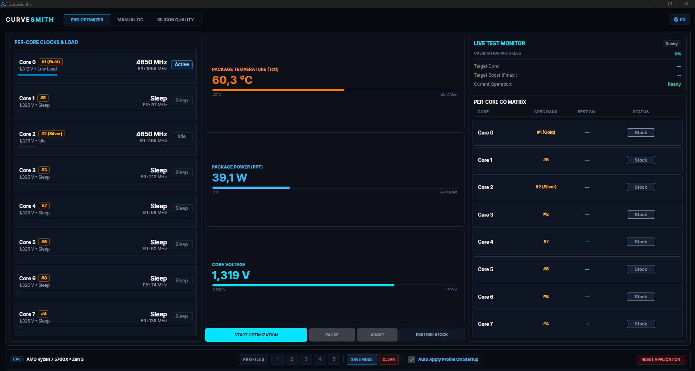
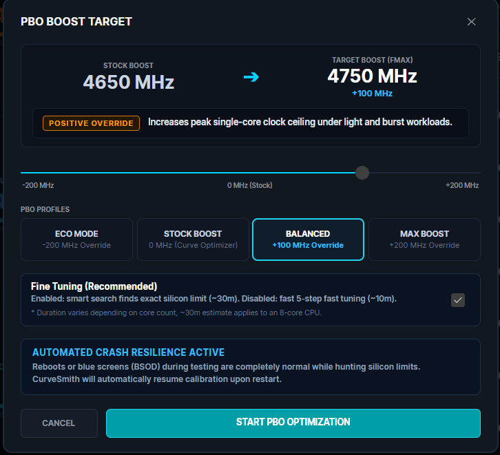
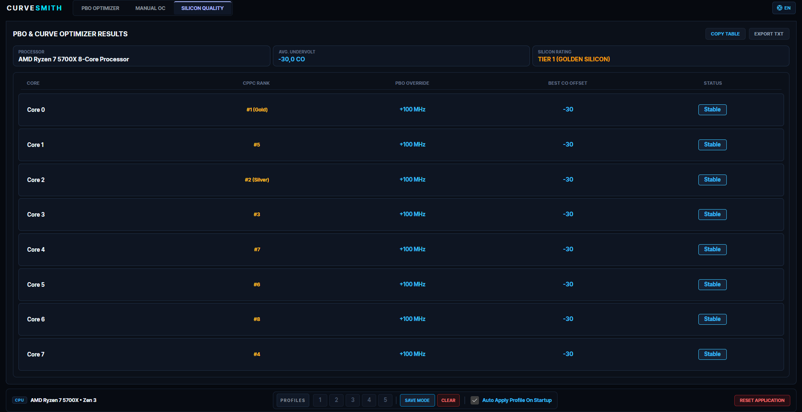
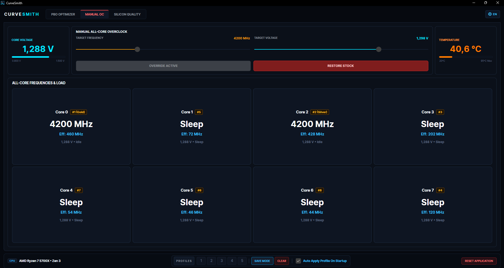

# CurveSmith - Precision PBO & Curve Optimizer Tuner

A lightweight, automated Curve Optimizer (CO) calibrator and low-level SMU tuning utility for AMD Ryzen processors.

  

Instead of spending an entire weekend manually tweaking offsets in BIOS and guessing which core crashed your system, CurveSmith dials in stable, per-core undervolts through direct hardware mailbox calls and targeted single-core stress routines.

---

## Why CurveSmith?

- **Fast Calibration (~30 Mins for 8 Cores):** Traditional tools brute-force offsets from 0 to -30 step-by-step, taking hours. CurveSmith uses an adaptive search engine that reads CPPC priority and previous core behavior to home in on silicon limits quickly (~30 minutes on an 8-core CPU; ~10 minutes in fast mode).
- **Full Desktop Architecture Coverage:** Native SMU profiles and tailored workloads for:
  - Zen 3 & Zen 3+ (Vermeer / Ryzen 5000, 5000X3D)
  - Zen 4 (Raphael / Ryzen 7000, 7000X3D)
  - Zen 5 (Granite Ridge / Ryzen 9000, 9000X3D)
- **Direct Hardware Mailbox (Ring-0):** Applies CO offsets and boost overrides live via the PawnIO kernel driver. No Ryzen Master background services or BIOS reboots needed between offset adjustments.
- **Automated Crash & Reboot Resilience:** Finding silicon limits causes reboots by design. If the system crashes or drops a WHEA error mid-calibration, CurveSmith detects it upon reboot, registers the failing offset as a hard boundary, snaps back to the last verified safe baseline, and resumes testing automatically.
- **Architecture-Specific Stress Engines:** Binds directly to matching AVX2 / AVX-512 workload binaries (Kagari for Zen 3, Kizuna for Zen 4, Komari for Zen 5 dual 512-bit) with core affinity pinning and load-shock cycles to expose instability instantly.
- **Bilingual UI (EN / TR):** Complete native interface in English and Turkish with system locale auto-detection and an instant toggle.

---

## Interface & Modules

### 1. PBO Calibration & Target Setup

Configure Fmax override targets and execution parameters before initiating the calibration sweep.

  

- **Target Boost (Fmax) Slider:** Set negative or positive frequency overrides (-200 MHz to +200 MHz).
- **Predefined PBO Profiles:** Quick-select between Eco Mode (-200 MHz), Stock Boost (0 MHz), Balanced (+100 MHz), and Max Boost (+200 MHz).
- **Fine Tuning Mode:** Toggle between bounded smart search (~30 min on 8 cores) and 5-step rapid testing (~10 min).
- **Automated Crash Resilience Engine:** Tracks active state to automatically recover and resume testing upon reboot.

---

### 2. Live PBO Optimizer Dashboard

Real-time telemetry and single-core test execution monitor.

  

- **Per-Core Clocks & Load:** Tracks active, idle, and C6 sleep states per physical core along with live effective clocks.
- **Hardware Telemetry:** Direct sensor readouts for Package Temperature (Tctl), Package Power (PPT), and Core Voltage.
- **Live Test Monitor:** Real-time calibration progress, target core identification, and step-by-step operation log.
- **Per-Core CO Matrix:** Visual matrix tracking CPPC rank tags (#1 Gold, #2 Silver) and confirmed stable negative offsets.

---

### 3. Silicon Quality & Results Table

Post-calibration report detailing per-core stability limits and fused silicon rating.

  

- **Silicon Tier Classification:** Calculates an overall binning score based on average stable undervolt capability (e.g., Tier 1 Golden Silicon).
- **Per-Core Audit Table:** Displays CPPC ranking, assigned PBO override, final stable CO offset, and validation state.
- **Export Options:** One-click clipboard copy (`COPY TABLE`) or raw plain-text report generation (`EXPORT TXT`).
- **Profile Storage:** 5 hardware profile slots with an option to auto-apply verified offsets on Windows startup.

---

### 4. Static Manual All-Core Overclocking

Dedicated tuning interface for non-X3D processors to test fixed frequencies outside AMD FIT regulation.

  

- **Dual Slider Control:** Direct adjustment of target all-core frequency and core voltage.
- **Real-Time State Mapping:** Monitors per-core active clocks and sleep states to verify static lock across all threads.
- **Safety Fallback:** Immediate `RESTORE STOCK` toggle to release hardware overrides back to factory PBO control.

---

## How It Works

1. **Topology & CPPC Mapping:** Queries hardware APIC IDs and MSR registers to map physical CCD/Core positions and read AMD preferred core rankings.
2. **Targeted Load Shocks:** Drives single-core workloads through y-cruncher kernels while rapidly toggling thread states to stress transient voltage drops (vDroop).
3. **Adaptive Range Refinement:** Narrows the stable margin between known-safe and known-failing offsets using bounded binary steps rather than linear 1-by-1 stepping.
4. **Permanent Slot Profiles:** Lets you save up to 5 tuning profiles to hardware slots with an option to auto-apply your daily profile on Windows startup.

---

## Requirements

- **OS:** Windows 10 / 11 (64-bit)
- **CPU:** AMD Ryzen Desktop Processor (Zen 3 through Zen 5)
- **Privileges:** Administrator rights (required for Ring-0 SMU and MSR communication)
- **Driver:** PawnIO low-level driver (packaged with the setup, prompts cleanly on first launch if missing)

---

## Installation

1. Download `CurveSmith_Setup.exe` from the Releases section.
2. Run the installer with administrator privileges.
3. Launch CurveSmith. If PawnIO is not installed on the system, the application will prompt the one-click driver setup.
4. Select your target boost offset in the PBO Optimizer tab and start calibration.

---

## Disclaimer

CurveSmith interacts directly
